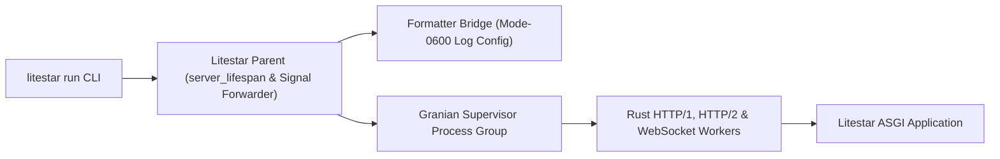

<h1 id="litestar-granian" class="granian-sr-only">Litestar Granian</h1>

<div class="granian-hero">
  <div class="granian-hero-lockup">
    
    <div class="granian-hero-divider" aria-hidden="true"></div>
    <span class="granian-brand-text">Litestar Granian</span>
  </div>
  <p class="granian-hero-lead">
    Run Litestar applications on Granian while preserving Litestar server lifespans, signal supervision, logging formatters, and static asset serving.
  </p>
  <div class="granian-hero-actions">
    <a class="granian-cta granian-cta--primary" href="getting-started/quickstart/">Get Started</a>
    <a class="granian-cta" href="guides/configuration/">Configuration Guide</a>
    <a class="granian-cta" href="reference/">API &amp; CLI Reference</a>
  </div>
</div>

## Install

=== "uv"
    ```bash
    uv add litestar-granian
    ```
=== "pip"
    ```bash
    pip install litestar-granian
    ```
=== "pdm"
    ```bash
    pdm add litestar-granian
    ```
=== "poetry"
    ```bash
    poetry add litestar-granian
    ```

## Minimal Example

Register `GranianPlugin` on your `Litestar` application:

```python
--8<-- "docs/examples/app.py"
```

Start the server with the standard `litestar run` command:

```bash
litestar --app docs.examples.app:app run
```

## Explore Documentation

| Section | What You Will Find |
| --- | --- |
| **[Getting Started](getting-started/index.md)** | Installation, quickstart, `v0.16` migration notes, contribution workflow, and release changelog. |
| **[Guides](guides/index.md)** | Runtime configuration, event loops, automatic formatter matching, Prometheus metrics, native static files, and production deployment. |
| **[Reference](reference/index.md)** | [`GranianPlugin`](reference/plugin.md) API documentation, the generated [`litestar run` CLI reference](reference/cli.md), and [compatibility matrix](reference/compatibility.md). |

## Core Capabilities

| Capability | Summary |
| --- | --- |
| **Drop-In `litestar run`** | Replaces `litestar run` with a Granian-backed server command while preserving standard Litestar flags and `LITESTAR_*` environment variables. |
| **Supervised Process Group** | The Litestar parent process enters `server_lifespan` context managers once and supervises a Granian child process group with deterministic signal forwarding. |
| **Automatic Formatter Matching** | Reconstructs Litestar's active standard, JSON, or `structlog` formatter inside Granian workers without coupling parent handlers or queues across processes. |
| **Rust Static File Serving** | Serves static asset directories directly from Granian via `--static-path-mount` or `GranianPlugin(static="auto")` provider discovery. |
| **Free-Threaded Python Ready** | Tested across Python 3.11–3.15 including free-threaded `3.14t` and `3.15t` builds with `asyncio`, `uvloop`, `rloop`, and `winloop`. |

## Runtime Architecture

When `litestar run` starts, the Litestar parent process enters application `server_lifespan` hooks once, prepares a temporary mode-`0600` logging configuration if a compatible formatter is active, and spawns a supervised Granian worker group:


